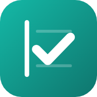
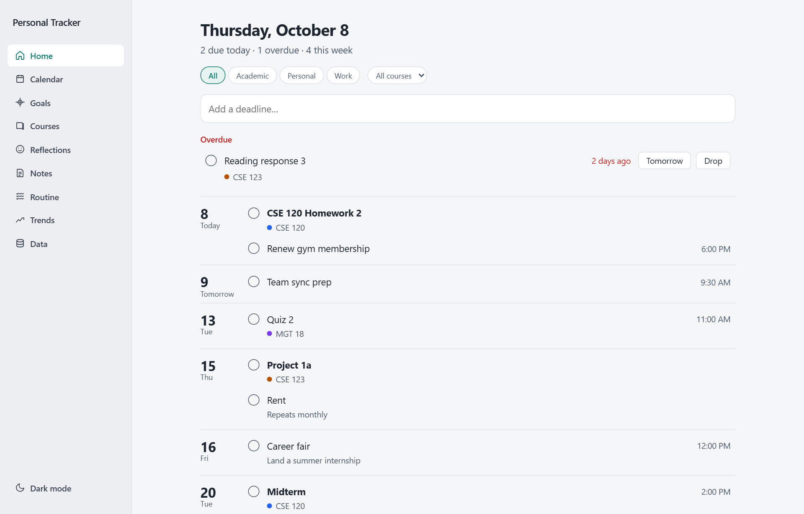
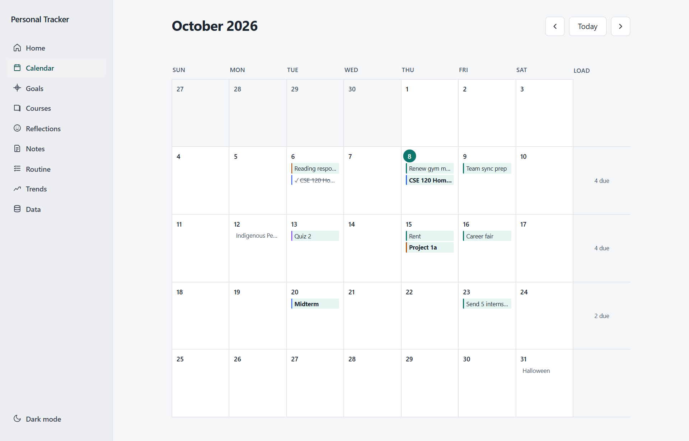
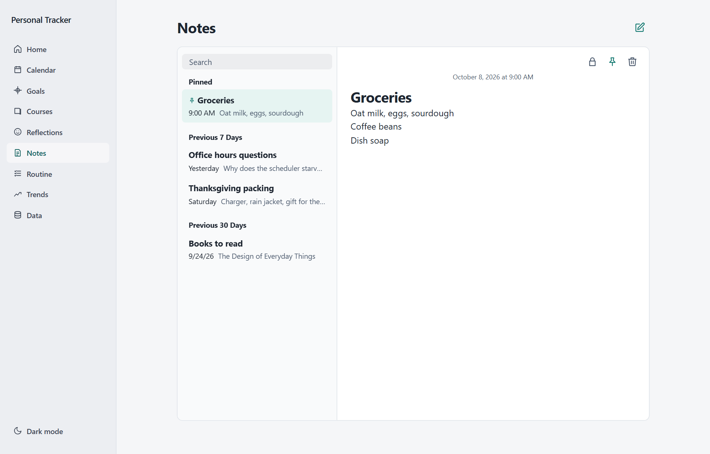
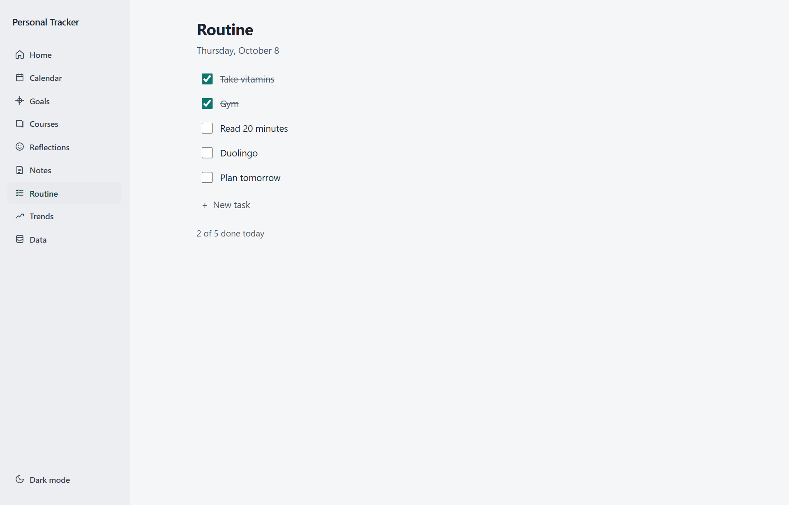

# Margin



[](https://github.com/AdityaJadhav17/Personal-Tracker/actions/workflows/ci.yml)

A personal dashboard for deadlines, notes, a daily routine, goals and courses.
It runs in your browser on your own laptop, and on your iPhone over your own
private network. No account, no cloud, nothing on the internet. (The
repository keeps its first name, Personal Tracker.)



| Calendar                                                                             | Notes                                                                    | Routine                                                                |
| ------------------------------------------------------------------------------------ | ------------------------------------------------------------------------ | ---------------------------------------------------------------------- |
|  |  |  |

How it fits together, drawn from the code itself:
[architecture](docs/diagrams/architecture.png),
[from an idea to the app](docs/diagrams/workflow.png) and
[where your personal data goes](docs/diagrams/personal-data.png). See
[Diagrams](#diagrams).

## What it does

Nine views, in a sidebar, and a button at its foot that switches between light
and dark. With no choice made, the app follows your system. On a phone-sized
window the sidebar becomes a floating tab bar, with the rarer views under More
and a + for adding from anywhere.

**Home** holds anything with a date and a consequence: a midterm, rent, a
dentist appointment, a friend's birthday. It opens on today's date and one line
that says how the day stands: "2 due today · 1 overdue · 4 this week". Scroll
and the large date gives way to a slim bar that keeps it in view.

- **Add a deadline…** is one line until you use it. Click it and the rest opens
  under it, the date already on today; press Enter and it folds away again.
  Pick a course while adding, once you have one.
- **Overdue** sits above everything under a red heading, so you never scroll
  past something you have already missed. Each row says how late it is and asks
  for one decision: done, **Tomorrow** (same time, next day), a new date, or
  **Drop**.
- Then the days, like a calendar's agenda: the date down the left, "Today" and
  "Tomorrow" for the nearest, the month named where it changes. A day with
  nothing due is not there at all.
- Only the next ten upcoming show, so a whole term never buries this week.
  Overdue items all show and do not count towards the ten. **Show more**
  reveals the rest until you reload.
- Within a day, high priority leads, and reads in bold.

Show All, Academic, Personal or Work to narrow the list to one kind of thing,
and pick a course to narrow it to one class. The two combine, so you can ask for
academic work for CSE 110. Neither choice is remembered: a reload shows
everything again, because a filter you forgot you set is a list that is lying
to you.

Tick the circle and it fills at once, then the row folds away. Delete and Drop
act at once too. Nothing asks "are you sure"; instead an **Undo** button floats
at the foot of the window, and `u` does the same from the keyboard.

Set something to repeat weekly or monthly and finishing it creates the next one,
so rent is recorded once instead of twelve times a year. The next one only
appears when you finish the last, which means a repeating item you ignore stops
repeating. Open an item to start or stop it repeating later, so moving out
means switching rent off rather than deleting it.

Pick a date, and a time if it needs one. With no time, a deadline means 23:59
that day. Dates are stored as fixed moments, so a deadline set at 5pm still
reads as 5pm on the other side of a daylight saving change.

A row shows what a thing is rather than how to change it: its title, the time if
it is not the 11:59pm a bare date means, and underneath, the course with its
colour, the goal, whether it repeats, and anything you wrote about it. Each
course keeps one colour everywhere, in the order you added them. Click the title
to open the controls that change those: rename it, move its deadline when a
professor does, set its course or goal, or delete it. Edits save as you go;
there is no Save button.

A project that takes more than an evening can be broken into **steps**: open it
and add a step with its own title and date. Each step is a deadline in its own
right, in the list, on the calendar and on your phone, and it takes the
project's course and goal. The project says how many of its steps are done.
Deleting a project takes its steps with it, and Undo brings them all back.

**Calendar** lays the same items out as a month, so you can tell a heavy week
from a light one before it arrives. A column counts each week's deadlines and
marks six or more as heavy. Goals show on their target day, outlined so they
never read as one more deadline, and finished items stay on their day, ticked
and struck through. Repeats show for the months ahead, dashed until they are
real.

US holidays are marked on their days: the eleven federal ones, with the weekday
they are observed when one falls on a weekend, and the common days such as
Mother's Day and Halloween. They are labels, not deadlines, and the app works
them out from their rules, so they are right in any year with nothing fetched.

Press anywhere in a day and it opens beside it with every row in full, so
anything a row can do on Home works from the calendar too. Type a title at the
bottom to add something to that day; it is kept even if you click away without
pressing Add. Drag an item to another day to move it, keeping its time, or hold
Ctrl as you drop to copy it there instead. Hold it over Next month or Previous
month to carry it further.

**Goals** are things to aim at with a date on them. Items can belong to a goal,
and each goal shows how much of its work is finished and how long is left.

**Courses** keeps the details you would otherwise dig out of email every week:
where it meets, your professor's address, when office hours are. Edit a course
in its card when you learn the rest a week into term.

**Reflections** asks how the day went, on a scale of five, with a note. One
entry per day.

**Notes** works like Apple Notes: a list beside the open note, grouped Today,
Previous 7 Days, Previous 30 Days and then by month. The first line is the
title, set large as you type, and every keystroke is saved. Search finds a note
by any word in it, pins keep the ones you use daily at the top, and a deleted
note comes back with Undo.

Lock a note to keep it private. Its text is encrypted in the browser with a key
made from a passcode you set, and only its first line stays readable, as its
title. Locked notes open with the passcode, and lock again when you leave
Notes or after five minutes without typing. The passcode can be changed, but it
cannot be recovered: forget it and the locked notes are gone.

**Routine** is a checklist for the things you do most days, typed in like
Notion: Enter starts the next line, Backspace on an empty one removes it. Tick
what you have done today. Every morning it starts fresh, all unticked, so a
missed day leaves nothing overdue behind.

**Trends** plots those reflection scores and what you finished, one point per
day, each chart with its scale and dates; hover to read a day. The exact numbers
are a click away under **Show the numbers**.

**Data** holds everything that moves data in or out, each with a line saying
what it is for. When a backup is due, a dot on Data in the sidebar says so
from any view.

Paste a list fills a whole term at once: one line each, a date, an optional
time, then the title. It shows you what every line was understood as, and lists
the ones it could not read, before anything is saved. The format is strict on
purpose: it reports a line it cannot read rather than guessing at it.

Add from calendar file reads an `.ics` from Canvas or a course site, the
"Download iCal File" kind. It shows what it found and what it left out, such as
anything already past or already in your list, and adds nothing until you press
Add. It can put everything under one course. You do the download; the app still
makes no network request.

Export everything to a JSON file you keep, and import it back on another
machine. Files written by every earlier version still import. Once a week has
passed since the last export, a line by the Export button says so, and Data
gets its dot.

Or let it back up by itself: **Choose backup folder** in Data, once. The app
then writes `personal-tracker-backup-YYYY-MM-DD.json` there when it opens and a
few seconds after each change, keeps the newest 30 days, and deletes nothing
else in the folder. Import restores any of them. Pick a folder outside
OneDrive if the copies should stay off the internet, and copy the folder to a
flash drive now and then. Edge and Chrome only; if the browser wants
permission again, Data says backups are paused and offers one button.

Export calendar writes an `.ics` file of every open deadline, with reminders
set by priority: a high priority item warns a day before and an hour before, a
normal one at 8pm the evening before, and a low one not at all. Import it into
the calendar on your phone and the phone does the reminding, which is the only
way this app reaches you while it is closed. Re-importing updates the events
rather than duplicating them.

## Run it

You need [Node](https://nodejs.org) 20 or newer.

```bash
git clone https://github.com/AdityaJadhav17/Personal-Tracker.git
cd Personal-Tracker
npm install
npm run dev
```

That serves the app at http://localhost:5173. Nothing else to configure, and no
database to set up: your deadlines live in the browser's own storage.

## Use it every day

`npm run dev` is for working on the app. To use it without opening a terminal,
build a copy outside the repo and serve that instead:

```bash
npm run deploy   # builds into %LOCALAPPDATA%\PersonalTracker
npm run live     # serves it at http://localhost:4180, this laptop only
```

The copy lives outside the repo so that a build on a half-finished branch never
changes the app you rely on. It only changes when you run `deploy` again, and
the running server picks the new files up without a restart: reload the window.

`npm run live` is `scripts/serve.mjs` (US-74): a small server built on Node's
own modules, listening on this laptop only. To have it always running, with
no window and nothing to start, register it once as a task that starts at
login, keeps going on battery, and restarts itself if it stops. It runs from
the updater's clone (below), so set that up first.

```powershell
$node = (Get-Command node).Source; $script = "$env:LOCALAPPDATA\PersonalTracker-src\scripts\serve.mjs"; $action = New-ScheduledTaskAction -Execute 'conhost.exe' -Argument "--headless `"$node`" `"$script`""; $atLogon = New-ScheduledTaskTrigger -AtLogOn -User "$env:USERDOMAIN\$env:USERNAME"; $settings = New-ScheduledTaskSettingsSet -StartWhenAvailable -MultipleInstances IgnoreNew -ExecutionTimeLimit ([TimeSpan]::Zero) -RestartCount 999 -RestartInterval (New-TimeSpan -Minutes 1) -AllowStartIfOnBatteries -DontStopIfGoingOnBatteries; Register-ScheduledTask -TaskName 'Personal Tracker server' -Action $action -Trigger $atLogon -Settings $settings; Start-ScheduledTask 'Personal Tracker server'
```

To stop it for good, `Unregister-ScheduledTask 'Personal Tracker server'`.

Then open http://localhost:4180 and install it as an app: in Chrome, the ⋮ menu,
then **Cast, save, and share**, then **Install page as app**; in Edge, Apps,
then **Install this site as an app**. Pin it to the taskbar. Stay with one
browser: each keeps its own copy of the data.

`npm run deploy` checks its own output and fails, naming the files, if the
deployed `index.html` and its assets do not match.

### Updates by themselves

Once this is set up, pushing to `main` is enough: four to eight minutes later,
once CI has passed, the app has the change and a reload shows it. A commit
whose CI failed is never deployed.

Run this once from the repo folder. It makes its own clone in
`%LOCALAPPDATA%\PersonalTracker-src` and deploys `main`:

```powershell
node scripts/update.mjs
```

Then register the task that runs it every five minutes, with no window:

```powershell
$node = (Get-Command node).Source; $script = "$env:LOCALAPPDATA\PersonalTracker-src\scripts\update.mjs"; $action = New-ScheduledTaskAction -Execute 'conhost.exe' -Argument "--headless `"$node`" `"$script`""; $every = New-ScheduledTaskTrigger -Once -At (Get-Date) -RepetitionInterval (New-TimeSpan -Minutes 5); $settings = New-ScheduledTaskSettingsSet -StartWhenAvailable -MultipleInstances IgnoreNew -ExecutionTimeLimit (New-TimeSpan -Minutes 30) -AllowStartIfOnBatteries -DontStopIfGoingOnBatteries; Register-ScheduledTask -TaskName 'Personal Tracker update' -Action $action -Trigger $every -Settings $settings
```

To skip the wait after a push, run `Start-ScheduledTask 'Personal Tracker update'`.
What it did is in `%LOCALAPPDATA%\PersonalTracker-update.log`. To stop it,
`Unregister-ScheduledTask 'Personal Tracker update'`.

**Your data does not move by itself.** The browser keeps storage per address,
so 4180 starts empty. Export from 5173 once, Import it at 4180, and from then
on 4180 holds your real deadlines and 5173 is only for development.

### On your iPhone

Over [Tailscale](https://tailscale.com), a private network of only your own
devices: encrypted from the laptop to the phone, and never public. Install it
on both, signed in to one account, with Tailnet Lock on so no third device can
join without one of them approving it.

1. On the laptop, once: `tailscale serve --bg 4180`. 4180 is then reachable at
   `https://<laptop>.<tailnet>.ts.net` from your devices only, and stays so
   across restarts. Never `tailscale funnel`, which makes it public.
2. On the iPhone, open that address in Safari, then Share, then **Add to Home
   Screen**. Margin opens full screen from its icon, and opens with no
   connection too, from what it kept; a deploy shows the next time it can
   reach the laptop.
3. The phone keeps its own data, separate from the laptop's. To start it with
   yours: Export on the laptop, send the file with Taildrop (the Share menu,
   then Tailscale), and Import it on the phone. Sync is not built yet.

The server answers its Tailscale name only because it asks Tailscale for it;
any other name still gets a 403. Automatic backups need a folder, which iOS
does not let a page write to, so the phone has Export.

## Test it

```bash
npm test          # unit and component tests, with coverage
npm run e2e       # end to end in a real browser
npm run lint      # eslint, fails on any warning
npm run typecheck # tsc
npm run build     # typecheck, then a production build
```

The end-to-end suite drives a real Chromium, so install it once:

```bash
npx playwright install chromium
```

## Your data

Everything sits in this browser's `localStorage`, under one key. It never
travels: the app makes zero network requests after the page loads, and a
Playwright spec checks that on every CI run.

Two things follow from that.

**Clearing site data deletes your deadlines.** Turn on automatic backups, or
use Export now and then, and keep the file somewhere you trust. Import restores it exactly, which a round-trip
test proves against a real downloaded file.

**Anyone at your unlocked laptop can read it,** as can any browser extension you
have installed, apart from locked notes. The app stores everything else as
plain text, on the reasoning that full-disk encryption already covers the
realistic threat and a passphrase prompt at every launch would wreck an app
whose whole value is being quick to check. Locked notes are the exception you
choose, one note at a time: AES-GCM under a key made from your passcode, which
is never stored.
[docs/engineering/decisions.md](docs/engineering/decisions.md) records both
decisions in full, and [SECURITY.md](SECURITY.md) says how to report a problem.

Exported files match a pattern in `.gitignore`, so you cannot commit your own
deadlines by accident.

## Not in this version

No accounts, no cloud sync, no hosted backend, no app store app, no
collaboration. GitHub holds the source and nothing else.

Also absent, and deliberately: push notifications. A browser tab on a laptop
cannot reach your phone without a server, so the app itself reminds you only
while it is open. The calendar export routes around that by letting your phone's
own calendar do the reminding.
[docs/product/v3-plan.md](docs/product/v3-plan.md) is the proposal for a private
server that would add nudges, and it is waiting on a spike.

## Diagrams

[docs/diagrams](docs/diagrams) holds three diagrams of this repository, made
with [Archify](https://github.com/tt-a1i/archify). Every box and arrow cites the
lines of code it comes from, pinned to one commit, and Archify checks those
citations before drawing anything.

- [Runtime architecture](docs/diagrams/architecture.png): the local server, the
  app, its storage and the note lock inside the page's security policy, and the
  updater that deploys `main`.
- [From an idea to the app](docs/diagrams/workflow.png): story, approval,
  test-first building, CI, and the deploy that only follows a passing run.
- [Where your personal data goes](docs/diagrams/personal-data.png): in from
  typing or a checked file, held in the tab, stored in one key, and out only as
  a file you save.

Each has an interactive `.html` beside it (download it and open it in a
browser) and the `.json` it is drawn from, so it can be redrawn when the code
changes.

## How it is built

React 18 and TypeScript on Vite. Vitest with React Testing Library for unit and
component tests, Playwright for end to end.

Two runtime dependencies, React and React DOM. No component library, no state
library, no router, no date library and no chart library: the sidebar icons and
the trend charts are inline SVG, and the colour palette is checked for contrast
by a test that reads the design tokens. Every view is also scanned for WCAG 2.2
AA in both colour schemes on every CI run,
and again with the system asking for more contrast, which strengthens borders
and muted text. Text sizes are in rem, so Chrome's font size setting scales
them.

[docs/](docs/README.md) holds the rest: the user research every test ID traces
back to, the data model, and a decision log that explains why each choice went
the way it did, including the ones that were wrong first.

## Licence

MIT. See [LICENSE](LICENSE).
